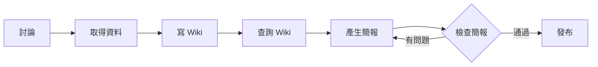
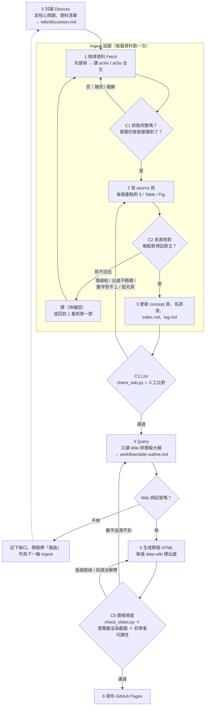

# Loop / Graph 設計

> 執行者：我 + Claude（AI 負責抓資料、寫 Wiki、寫簡報、跑檢查；我負責討論、決定範圍、審閱）。
> 規則寫在 [CLAUDE.md](../CLAUDE.md)，實際執行紀錄在 [wiki/log.md](../wiki/log.md)。

## v1：一開始的設計（線性，只在最後檢查）

問題：檢查只在最後一步，而且只能檢查「簡報和 Wiki 一不一致」。如果錯誤是在**寫 Wiki 時**就進來的（例如摘要說錯一個數字），簡報檢查會照樣通過，因為簡報忠實地引用了錯的 Wiki。

## v2：實際執行一次之後的設計（加了 4 個檢查節點、3 個迴圈）

## 哪些步驟會重複執行？

| 迴圈 | 重複什麼 | 什麼時候停 |
|---|---|---|
| **Ingest 迴圈** | 1 → C1 → 2 → C2 → 3，每篇資料跑一次（這次跑 6 次） | 6 篇都寫完 |
| **重抓迴圈**（C1、C2 → 1） | 抓取被拒、內容被截斷、或某個重點對不回原文時，回去重抓**那一節** | 需要的章節都讀到，或確定原文沒寫（就標〔待確認〕） |
| **Lint 迴圈**（C3 → 2） | 腳本報錯就回去改 source / concept 頁，再跑一次 | 顯示「全部通過」 |
| **簡報修正迴圈**（C5 → 4 或 5） | 數字對不上回到 Query；版面、術語問題回到生成 | 腳本通過 + 截圖人工看過 |
| **外層迴圈**（C4 → 0） | Query 發現 Wiki 不夠，就記成下一輪的資料需求 | 這次記下「指甲法向量估計」這個缺口，留到下一輪 |

## 哪些地方需要檢查或重新生成？

| 節點 | 檢查什麼 | 怎麼檢查 | 沒過的話 |
|---|---|---|---|
| C1 抓取完整 | 抓取有沒有被拒、有沒有被截斷 | 看工具回傳的錯誤與「截斷 / Gaps」註記 | 換來源（ar5iv）或用 offset 讀後半段 |
| C2 來源核對 | 每個重點都有精確出處、對得回原文 | 寫的時候附 § / Table；對不回去的標〔待確認〕 | 重抓那一節，或標待確認 |
| C3 Lint | 壞連結、孤兒頁、index 缺漏、出處不精確、**concept 頁的數字是否出現在 source 頁** | `scripts/check_wiki.py` + 人工逐條比對 | 回去改頁面 |
| C4 Wiki 足夠 | 簡報要講的東西 Wiki 裡有沒有 | Query 時逐張對照 | 記缺口；不用模型記憶補 |
| C5 簡報 | 每張有 data-wiki、數字可追溯到引用頁、大綱一致、圖片 alt、版面、術語 | `scripts/check_slides.py` + Playwright 截圖 + 人工以初學者角度讀 | 回到 Query 或重新生成 |

## 為什麼這樣設計？

1. **Wiki 是唯一的事實來源。** 簡報只能從 Wiki 拿內容（Query 節點規定「Wiki 沒有就不講」），所以只要 Wiki 是對的，簡報就不會亂講。反過來說，Wiki 錯了，後面全部跟著錯 → 檢查必須放在 Wiki 這一層，不能只放在簡報。
2. **越早抓到錯越便宜。** 在 ingest 時發現「這個數字原文沒有」，只要改一行；等到簡報做完才發現，要回頭改 source 頁、concept 頁、比較頁、簡報四個地方。
3. **讓錯誤可以被機器抓到。** 規定每個重點附章節號、每張投影片附 data-wiki，檢查腳本才有辦法自動比對。沒有出處的內容，腳本會直接擋下。
4. **「不知道」也要留下紀錄。** 〔待確認〕和「推論」標記讓讀者分得出哪些是論文說的、哪些是 Wiki 自己推出來的，也讓下一輪 ingest 知道要補什麼。
